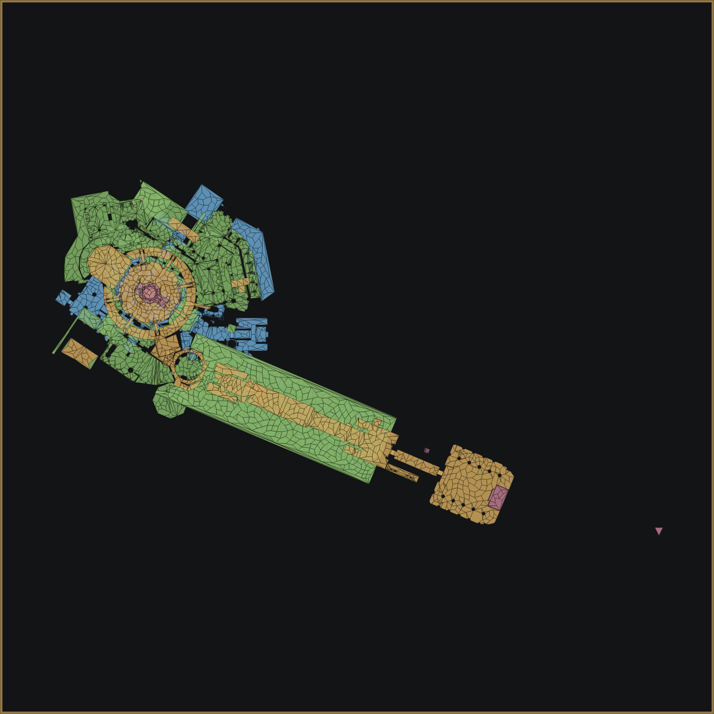

# DS3 Minimap

Dark Souls III is a wonderful place to get gloriously lost. DS3 Minimap is a
small, friendly on-screen companion that gives you a simple answer to “where am
I?” without asking you to stop playing, alt-tab to a wiki, or memorise every
twist of a castle corridor.

It was made for my sister, who has
[aphantasia](https://en.wikipedia.org/wiki/Aphantasia): she can enjoy exploring
but does not form a clear mental picture of places she has already travelled.
The minimap gives her a gentle visual record of the route behind her and a clear
“you are here” point for the route ahead. It is simply a navigation aid, not a
medical tool, but I hope it can make a first playthrough feel a little less
disorienting for anyone who finds spatial navigation difficult.

<p align="center">
  
</p>

## What it helps with

- A clear player marker that turns as you turn.
- A softly dotted trail showing the route you have just taken.
- Automatic map and floor changes, with a smooth fade when you move between
  levels.
- Bonfires by default, plus an optional setting for uncollected items.
- A choice of size, position, colours, map shape, zoom, trail length and more.

The map is made from the navigation information in **your own installed copy of
DS3**, not downloaded artwork. Here is a real example: the layered navigation
map prepared for the Grand Archives interior. The coloured shapes are walkable
areas on different heights; they are what the minimap uses to help place you.

<p align="center">
  
</p>

## The easy setup

You only need a fully installed Steam copy of **Dark Souls III** and a Windows
10 or Windows 11 64-bit PC. You do **not** need Git, PowerShell, Visual Studio,
.NET, Smithbox, Node.js, Python, or any other developer software.

1. Download `DS3Minimap-Setup-<version>-win-x64.exe` from the
   [Releases page](https://github.com/HazzJC/DS3MiniMap/releases).
2. If DS3 is newly installed, start it once, wait for the main menu, then close
   it. This is just so DS3 creates its normal graphics settings file.
3. Run the DS3 Minimap setup program. It installs only for your Windows user;
   administrator permission is not needed.
4. Leave **Launch DS3 Minimap** ticked at the end of installation.
5. Keep DS3 closed while the first-run “Preparing your local map package” window
   is working. It takes a few minutes and shows its progress. It only reads your
   game files; it never changes them.
6. When it finishes, start DS3 from Steam, load your character, and play.

For future play sessions, start DS3 Minimap first (from the Start menu or its
desktop shortcut), then launch DS3. The map stays hidden until the game has focus.

### Once you are in the game

- `Ctrl+Shift+M` opens the settings window.
- `Ctrl+Shift+H` hides or shows the map.
- `Ctrl+Shift+C` clears the trail for the current play session.

If a tall building ever shows the wrong level, `Ctrl+Shift+PageUp` and
`Ctrl+Shift+PageDown` let you temporarily choose the floor above or below.

> [!NOTE]
> The overlay works best in windowed or managed-borderless mode. The first-run
> wizard can set this up and keeps a backup of DS3’s original graphics settings.
> Normal Windows overlays cannot reliably appear over exclusive fullscreen.

## A few reassuring details

This is an unofficial third-party tool. It reads only the local player position,
direction, map, and—if you enable uncollected-item markers—the relevant pickup
flags. It does **not** inject into DS3, change game memory, patch game code,
alter game files, or send game information over the network. Using any
memory-reading tool is still at your own risk, so offline play is strongly
recommended.

The current release supports the Steam version of DS3 (`1.15.2.0`) and the base
game. DLC may be installed, but its areas are not mapped yet.

## Thoughts, feedback, and gentle suggestions are very welcome

If the map is confusing, a floor changes at the wrong moment, a bonfire is
missing, a setting is hard to find, or you simply have an idea that would make
the tool kinder and easier to use, please open an
[issue or suggestion](https://github.com/HazzJC/DS3MiniMap/issues). Screenshots,
the area name, and a short description of what you expected are especially
helpful—but even “this feels awkward” is useful feedback.

## For curious players and contributors

Everything above is all a player needs. The rest of this document explains how
to build, inspect, or package the project from source.

## Development bootstrap

The source checkout retains a developer-only bootstrap for rebuilding the
application, baking review artifacts, or creating a new installer release. It
is not required by end users.

### 1. Open PowerShell in the project folder

Open your `DS3Minimap` checkout folder in File Explorer, click the address bar, type
`powershell`, and press Enter. Alternatively, open PowerShell and run:

```powershell
Set-Location "C:\path\to\DS3Minimap"
```

### 2. Make sure DS3 and Steam downloads have finished

In Steam, confirm that Dark Souls III is not downloading, updating or verifying
files. DS3 itself should be closed while the map package is generated.

The default game directory is:

```text
C:\Program Files (x86)\Steam\steamapps\common\DARK SOULS III\Game
```

### 3. Run the one-command bootstrap

From the repository root, run:

```powershell
powershell -NoProfile -ExecutionPolicy Bypass -File .\scripts\bootstrap.ps1
```

No administrator permission is required. The command:

1. Installs the pinned .NET SDK under `.tools\dotnet`.
2. Downloads the pinned Smithbox source dependency under `.deps\smithbox`.
3. Restores locked NuGet dependencies under `.cache`.
4. Builds the complete solution in Release mode.
5. Runs the automated tests.
6. Publishes a self-contained Windows executable.
7. Reads the installed game archives and generates the base-game map package.

The initial run may take several minutes. The first full environmental bake
reads thousands of placed DS3 map pieces and can take roughly 5-10 minutes,
depending on storage and CPU speed. Later runs reuse the finished package and
skip map generation when the game archives and package schema are current.

A successful run ends with:

```text
DS3 Minimap bootstrap completed successfully.
```

The runnable application is created at:

```text
artifacts\publish\win-x64\DS3Minimap.App.exe
```

### DS3 installed in another Steam library

The script searches Steam libraries automatically. If detection fails, provide
the exact `Game` directory:

```powershell
powershell -NoProfile -ExecutionPolicy Bypass -File .\scripts\bootstrap.ps1 `
  -GameDir "D:\SteamLibrary\steamapps\common\DARK SOULS III\Game"
```

The path must be the directory containing `DarkSoulsIII.exe`, not the parent
`DARK SOULS III` directory.

## Running a development build

Use this order for the first run:

1. Make sure DS3 is closed.
2. Start `artifacts\publish\win-x64\DS3Minimap.App.exe`.
3. Read and accept the unofficial-tool safety notice.
4. Choose **Yes** when asked to configure managed borderless mode.
5. Leave DS3 Minimap running. It will wait quietly for the game.
6. Put Steam into Offline Mode if desired.
7. Launch Dark Souls III through Steam.
8. Load a character and enter the game world.

The overlay is hidden while DS3 is not running, minimized or unfocused. Once a
character is loaded and DS3 has focus, the minimap should appear in the
top-right corner.

Managed-borderless setup backs up the existing graphics configuration to:

```text
%AppData%\DarkSoulsIII\GraphicsConfig.xml.ds3minimap-backup
```

It then changes DS3 to windowed mode. While DS3 is running, the minimap removes
the game window border and tracks the game client area. The original file is not
deleted.

### Normal launches after first-time setup

For later play sessions, the recommended order is:

1. Start Steam, preferably in Offline Mode.
2. Start `DS3Minimap.App.exe`.
3. Launch DS3.
4. Load a character.

Starting the minimap after DS3 is already running also works after the initial
managed-borderless setup. Both programs must run at the same Windows privilege
level. Normally, neither should be run as administrator.

## Controls

The hotkeys are global and work while DS3 has focus:

- `Ctrl+Shift+M` - open settings and diagnostics
- `Ctrl+Shift+H` - manually hide or show the overlay
- `Ctrl+Shift+C` - clear the current session trail
- `Ctrl+Shift+PageUp` - temporarily select a higher map floor
- `Ctrl+Shift+PageDown` - temporarily select a lower map floor

The floor override resets when the internal DS3 map changes. It is intended for
areas where several walkable floors overlap and automatic elevation selection
does not choose the desired level.

## Settings

Open settings with `Ctrl+Shift+M`. Available options include:

- Overlay size, zoom and opacity
- Top-left, top-right, bottom-left or bottom-right placement
- Player-up or north-up orientation
- Circular, rounded-square or square mask
- Background, map, player and trail colours
- Configurable inked map-edge, bronze frame and player-outline colours
- Procedural aged-ground etching and grain with adjustable strength
- Smooth, adjustable cross-fades between elevation layers
- Bonfire markers (enabled by default)
- Read-only uncollected-item markers (disabled by default), which disappear as
  their DS3 pickup event flags are set
- Marker size plus separate bonfire and item colours
- Animated coiled-sword bonfire and rising item-wisp symbols that remain upright
  while a player-up map rotates
- Layered, cloud-like fractal ground noise clipped to navigation geometry
- Trail-dot size
- Trail duration from 0 (whole session) to 180 minutes
- Optional gradual age fade for duration-limited trails
- Dark navigation-boundary and player-marker outlines for contrast
- Hide when DS3 is unfocused
- Managed-borderless window handling
- Optional persistent trail history
- JSON or CSV export of the current trail

Session trails are kept in memory by default and disappear when the minimap is
closed. Enabling persistent history stores new trail points in a local SQLite
database.

## Generated files and privacy

Project-local downloads and build output:

```text
.tools\                 Local .NET SDK
.deps\smithbox\         Pinned map-format source dependency
.cache\                 NuGet and installer cache
artifacts\bin\          Compiled development output
artifacts\publish\      Self-contained application
```

User data is stored beneath `%LocalAppData%\DS3Minimap`:

```text
%LocalAppData%\DS3Minimap\settings.json
%LocalAppData%\DS3Minimap\data\trails.sqlite3
%LocalAppData%\DS3Minimap\maps\1.15.2\base.dsmaps
```

The generated `.dsmaps` file is produced locally from your installed game. It
contains simplified AI-navigation polygons plus bonfire and trackable treasure
metadata, not game textures or item models. Do not
redistribute generated game-derived map packages.

## Generating and visually checking the map package

Close DS3 before rebuilding its maps, then run this command from the project
folder:

```powershell
powershell -NoProfile -ExecutionPolicy Bypass -File .\scripts\generate-maps.ps1 `
  -Force -OpenPreviews
```

This is the recommended map-development command. `-Force` rereads DS3's
installed archives and replaces the package only after a complete successful
bake. `-OpenPreviews` opens a local HTML gallery containing a top-down SVG for
every base-game map. Each elevation layer has a different colour so stacked
floors and suspicious gaps are easy to spot. Orange circles show resolved
bonfires and pale diamonds show treasure pickups whose collected state can be
read from a DS3 event flag.

If DS3 is installed outside the default Steam library, use:

```powershell
powershell -NoProfile -ExecutionPolicy Bypass -File .\scripts\generate-maps.ps1 `
  -GameDir "D:\SteamLibrary\steamapps\common\DARK SOULS III\Game" `
  -Force -OpenPreviews
```

To validate the current package and recreate only the diagnostic gallery,
omit `-Force`:

```powershell
powershell -NoProfile -ExecutionPolicy Bypass -File .\scripts\generate-maps.ps1 `
  -ReviewDir .\artifacts\map-review -OpenPreviews
```

`-ReviewDir` creates a portable review folder inside the project. It contains
12 navigation-only overviews and one SVG for each generated floor. All floor
SVGs use the same navigation-derived framing as their map overview, so they can
be overlaid or compared directly. The default remains the LocalAppData
`diagnostics` folder when this option is omitted.

The generator verifies all 12 supported internal map IDs, finite polygon and
marker coordinates, useful map extents, elevation layers, non-empty geometry,
and plausible base-game bonfire/pickup totals. A
validation failure returns a non-zero exit code instead of installing a partial
or corrupt package. Its outputs are:

```text
%LocalAppData%\DS3Minimap\maps\1.15.2\base.dsmaps
%LocalAppData%\DS3Minimap\maps\1.15.2\diagnostics\index.html
%LocalAppData%\DS3Minimap\maps\1.15.2\diagnostics\validation-report.json
```

The map uses only elevation-aware AI navigation surfaces. An earlier
experimental visual-context pass projected every FLVER map piece, but DS3's map
pieces include sky domes, horizon cards and distant scenery. Their top-down
convex hulls produced misleading circles and oversized polygons, so they are
excluded from both the package and live renderer.

AI navigation is intentionally not identical to player collision. A character
can stand beside props, on shallow water, at ledges, or in scripted spaces that
enemies cannot traverse. Those locations appear as gaps in the coloured
navigation layer even when the read player position is correct.

The minimap has no telemetry service, account system, update checker or network
client. Settings, generated maps and trail history remain on the computer.

## Bootstrap options

Skip map generation while working only on the application:

```powershell
.\scripts\bootstrap.ps1 -NoMapBake
```

Skip automated tests:

```powershell
.\scripts\bootstrap.ps1 -SkipTests
```

Redownload the local SDK or Smithbox dependency if its cache is damaged:

```powershell
.\scripts\bootstrap.ps1 -ForceDependencies
```

After one successful online bootstrap, build only from the existing local
dependencies without contacting package sources:

```powershell
.\scripts\bootstrap.ps1 -Offline
```

`-Offline` is not an installation mode. It fails with an explanatory message if
the SDK, source dependency or restore assets have not already been downloaded.

## Troubleshooting

### The bootstrap says DS3 was not found

Confirm that `DarkSoulsIII.exe` exists and pass its `Game` directory explicitly:

```powershell
.\scripts\bootstrap.ps1 -GameDir "E:\SteamLibrary\steamapps\common\DARK SOULS III\Game"
```

### The bootstrap says the Steam download is incomplete

Allow Steam to finish downloading, updating or verifying DS3. Close DS3 and run
the same bootstrap command again. Completed SDK and dependency downloads will be
reused.

### The game version is unsupported

Right-click `DarkSoulsIII.exe`, open **Properties**, and check the **Details**
tab. This release expects file version `1.15.2.0`. Memory signatures are rejected
when the executable version or layout does not match, because drawing a wrong
position is less safe than suspending telemetry.

### The minimap starts but nothing appears

Check the following:

1. DS3 is running and a character is fully loaded into the world.
2. DS3 has keyboard focus. The default setting hides the overlay when alt-tabbed.
3. Press `Ctrl+Shift+H` in case the overlay was manually hidden.
4. Press `Ctrl+Shift+M` and read the diagnostic status.
5. Confirm that the generated map package exists under
   `%LocalAppData%\DS3Minimap\maps\1.15.2`.
6. Use windowed or managed-borderless mode, not exclusive fullscreen.
7. Make sure DS3 and the minimap run at the same privilege level.

### Access denied when attaching to DS3

Close both applications. Start Steam, DS3 and the minimap normally without
**Run as administrator**. If DS3 was deliberately started elevated, the minimap
must use the same privilege level, but running neither elevated is preferred.

### The map is visible but the wrong floor is shown

Use `Ctrl+Shift+PageUp` or `Ctrl+Shift+PageDown`. Automatic floor selection uses
the player's world elevation, but DS3 contains tightly stacked rooms where a
temporary manual override may be clearer.

### The overlay does not appear over fullscreen DS3

Exclusive fullscreen prevents an ordinary external WPF overlay from reliably
appearing. Close DS3, restore windowed mode in its graphics settings, and use
managed borderless. If first-run setup was skipped, remove:

```text
%LocalAppData%\DS3Minimap\.first-run-complete
```

Then restart the minimap while DS3 is closed to show setup again.

### Restore the original DS3 graphics configuration

Close DS3 and the minimap. Copy:

```text
%AppData%\DarkSoulsIII\GraphicsConfig.xml.ds3minimap-backup
```

over:

```text
%AppData%\DarkSoulsIII\GraphicsConfig.xml
```

You can also disable **Managed borderless game window** in minimap settings.

### Reset minimap settings

Close the minimap and rename or delete:

```text
%LocalAppData%\DS3Minimap\settings.json
```

Default settings will be recreated at the next start. This does not delete the
generated map or persistent trail database.

### Hotkeys do not respond

Another program may already own the same global shortcut. Close software that
uses overlapping hotkeys, then restart the minimap. Also verify that the minimap
process is still running in Task Manager.

## Development commands

### Create the end-user installer

This is a maintainer-only command. It publishes the overlay and its bundled
map-preparation worker as self-contained Windows executables, then packages
both into a single per-user setup program:

```powershell
.\scripts\package-installer.ps1 -Version 1.0.0
```

The generated file is:

```text
artifacts\installer\DS3Minimap-Setup-1.0.0-win-x64.exe
```

The packaging machine needs the project bootstrap prerequisites plus
[Inno Setup](https://jrsoftware.org/isdl.php) (or a compiler supplied through
`-InnoSetupCompiler`). This requirement is only for creating releases; players
receive one setup executable and do not need Inno Setup, PowerShell, Git, a
.NET runtime, Smithbox, or the repository.

Build the solution:

```powershell
.\.tools\dotnet\dotnet.exe build .\DS3Minimap.slnx -c Release
```

Run tests:

```powershell
.\.tools\dotnet\dotnet.exe test .\DS3Minimap.slnx -c Release
```

Run directly from source:

```powershell
.\.tools\dotnet\dotnet.exe run --project .\src\DS3Minimap.App -c Release
```

Regenerate and visually inspect the map package explicitly:

```powershell
.\scripts\generate-maps.ps1 -Force -OpenPreviews
```

## Read-only safety boundary

The telemetry component opens `DarkSoulsIII.exe` with only:

```text
PROCESS_QUERY_LIMITED_INFORMATION | PROCESS_VM_READ
```

It uses `ReadProcessMemory` to obtain the player position and map context. There
is no `WriteProcessMemory` call, DLL injection, game-code patch, archive write,
or automatic network activity in the application.

When **Show uncollected items** is enabled, the same read-only handle polls only
the pickup event-flag IDs baked for the active map, twice per second. If flag
storage cannot be validated, item markers are hidden rather than incorrectly
claiming that already-collected items remain. Bonfires are static map landmarks
and remain useful regardless of whether they have been lit.

## Licence

Original project code is licensed under the MIT License. See `LICENSE` and
`THIRD-PARTY-NOTICES.md` for dependency information.
