# Making Dark Souls III navigable

I play a lot of video games, and I can normally navigate through them perfectly well. Minecraft probably taught me that. Spend enough time trying to find a hastily built wooden house without losing your diamonds and you develop a surprisingly durable mental compass.

My sister experiences navigation differently. She cannot visualise places in her mind; she thinks in words and thoughts rather than mental pictures. Many people share this experience, often described as aphantasia or low visual imagery. A route I remember as a picture has no internal image for her to revisit later.

That is a real problem in a game built from tangled paths, similar stone corridors and folding shortcuts.

Then she wanted to play **Dark Souls III**.

Dark Souls is difficult enough when you know where you are going. She would survive, explore, die, and have no reliable way to remember where she had come from or how to return to a bonfire. This was not teaching her to dodge or read an enemy. It was taxing a form of visual memory she does not have.

I decided that particular part of the difficulty was artificial for her—and that I should do something about it.

## The idea: support the journey, not solve the game

The goal was not to turn Dark Souls into a guided tour. I did not want a line pointing towards the next boss or anything playing on her behalf. The useful information was simpler:

- Where am I now?
- Which way am I facing?
- Where have I already walked?
- Where was the last bonfire?

That became the application: a small top-down overlay with a player marker and dotted breadcrumb trail. Bonfires are visible by default. Uncollected items are optional, so the map reveals no more than the player wants.

It does not remove combat, consequences, exploration or atmosphere. It substitutes for the mental map the game assumes players can build.

## How the minimap knows where you are

Dark Souls III was never designed to share map data, so the minimap runs as a separate Windows program. It opens the game with read-only permission. It cannot change health, move the character or edit inventory. It reads only the player's position, heading and current internal map ID.

Think of it like reading a car's dashboard rather than reaching under the bonnet. The game already knows the character's X, Y and Z coordinates; the minimap observes them about thirty times a second and places a marker on a two-dimensional surface.

It does not guess “this looks like Firelink Shrine.” It reads the active map resource, chooses the matching baked map, then selects the elevation layer that best fits the player's position and height.

The map is generated locally from the player's installation. A builder reads the game archives without changing them, extracts AI navigation surfaces and projects them from above. It groups separated geometry into floors and writes a compact package, so extracted textures or models are never distributed.

## Keeping it safe, local and reproducible

Memory-reading tools deserve a little suspicion, so safety shaped the architecture from the beginning. The application requests only permission to inspect the process and read memory. There is no DLL injection, code patching, memory writing or network service. If a pointer or value fails validation, telemetry pauses instead of drawing a plausible but wrong position. The tool is intended for offline play, and settings, logs, trail history and generated maps stay on the computer.

Reproducibility mattered too. The repository pins the .NET SDK, package versions and exact Smithbox source revision used to decode formats. Its bootstrap script reruns without downloading completed dependencies and offers a genuinely offline mode once files are cached. Setup therefore feels less like assembling a modding workstation and more like running one ordinary command.

## The first version was mostly a transparent circle

The earliest overlay worked in the strictest possible sense: it appeared over the game. Unfortunately, it was often just a transparent circle with an arrow floating in it.

Building the overlay and building the map are separate jobs. The application could read the player perfectly, but without a generated package it had nothing to draw. I added one-command setup that installs project-local dependencies, compiles and tests everything, finds Steam and generates the maps.

Map generation also produces an SVG review gallery for every region and floor. That turned “the map looks odd” into something inspectable before launching the game.

## When more accurate-looking data made the map worse

My first instinct was to use the game's visible environment models. Surely a top-down projection of the real level would make the best map?

It did not.

Levels contain more than floors and walls: distant scenery, decorative meshes, invisible helpers and enormous sky domes. Flattened from above, these became circles and slabs that swallowed useful paths. Road of Sacrifices looked as though somebody had put a dinner plate behind it.

Grand Archives happened to look convincing, making the mistake harder to spot. I stopped treating “visible in 3D” as meaning “useful for navigation” and returned to AI navigation meshes. They are not perfect player collision, but they show paths, rooms and connections much more clearly.

The gallery let me compare all twelve base-game resources instead of fixing whichever location was on screen.

## The arrow that faced the wrong way

Games and drawing systems do not always agree about “up.” Dark Souls uses X and Z for the ground and Y for elevation, while the screen has different axes and rotation. My original arrow could point away from the direction the character walked.

Correcting the conversion fixed the error, but I added a safeguard: while moving, consecutive positions reveal the visible travel direction. At rest, the marker falls back to character heading. The arrow now agrees with the world and breadcrumb trail.

## Blank space, stacked floors and Firelink Shrine

A marker in dark space is not always wrong. AI navigation is designed for enemies, not maps. Players can stand by props, in shallow water or on ledges where enemies never walk, leaving legitimate gaps.

Dark Souls also stacks bridges, tunnels and rooms. Height alone is insufficient because floor ranges overlap. The minimap scores elevation and distance from nearby polygons, uses hysteresis to prevent seam flicker, and cross-fades between layers. Manual floor controls remain for ambiguous places.

Firelink was the awkward case. Cemetery of Ash, Firelink Shrine and Untended Graves share one resource, arranged sensibly for the game but not a simple diagram. Diagnostics therefore expose the active map, layer and telemetry state so oddities can be investigated with evidence.

## Making an overlay behave politely

At one stage, opening settings was nearly impossible because Dark Souls kept wrestling back control. The overlay is normally always on top and click-through—ideal while playing, terrible when somebody needs to move a slider.

Opening settings now pauses updates, releases topmost status, activates a normal window and restores the overlay afterwards. It also supports reversible borderless mode, multiple monitors and DPI changes, and hides when the game is minimised or unfocused.

A game process can disappear between any two reads. Early builds produced repeated error boxes for this normal event. Now the overlay quietly stops, records a diagnostic and waits for the game to return.

## Breadcrumbs, bonfires and item wisps

The trail records only meaningful movement, staying readable instead of becoming solid. New segments begin after teleports, deaths, loads or map changes. Players can keep a session, apply a duration, fade older steps, clear it or save history locally.

Bonfires are extracted by matching parameter records to placed entities. Item markers combine treasure positions with pickup flags. When enabled, the overlay reads only relevant flags for the active region twice per second; collected wisps disappear. If memory cannot be validated, items hide rather than showing incorrect information.

Walkable ground gained parchment-and-stone colour, outlined edges and cloud noise. Bonfires use a coiled sword and ember glow; items use a rising blue-white wisp. Symbols stay upright while the map rotates, and floors fade rather than snap.

## What I learned

The most useful lesson was that diagnostics are part of the product. A generated gallery, deterministic packages, sanity checks, readable status and automated tests mattered more than any clever algorithm.

The second was to fail safely. Invalid coordinates pause the marker. Unknown flags hide items. A closed game produces silence, not panic. Restraint is a feature.

Most importantly, accessibility does not have to mean removing the thing people love. Dark Souls can still be severe, mysterious and demanding. But difficulty created by an enemy is different from difficulty created by an assumption about how somebody's mind represents space.

This project began because my sister could not picture the route back to a bonfire. The minimap does not build that picture in her head. It gives her something better: a visible record of her own journey, one small blue dot at a time.
